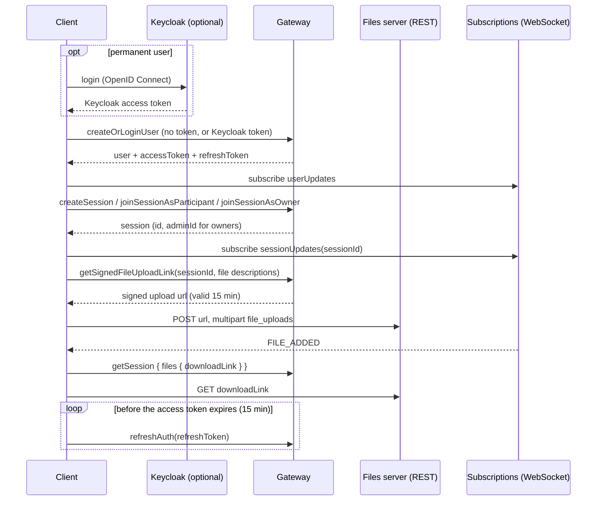
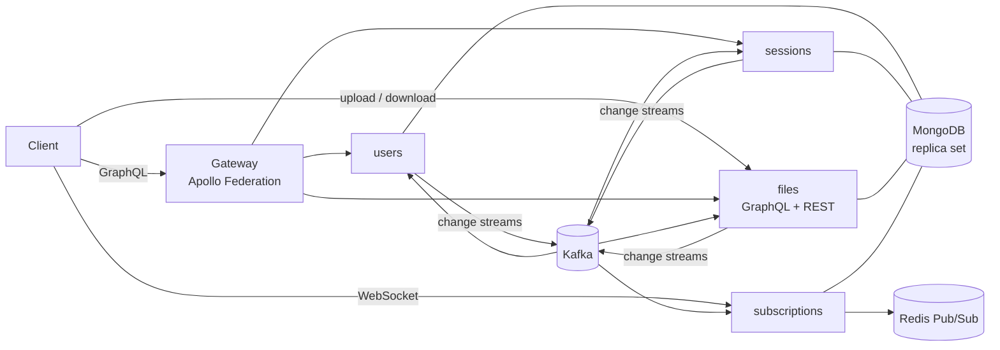

# How to use the API

This document describes what dd_services does from a client's point of view
and in which order the calls have to happen. It was reconstructed in 2026
from the code and from `dd_services.postman_collection.json`; where the code
behaves surprisingly, this is marked and collected in
[known-issues.md](known-issues.md).

## Endpoints

A client talks to three endpoints. Host names and ports come from `.env`
(the Postman collection assumes the gateway at `http://localhost:80`).

| Endpoint | Protocol | Used for |
|---|---|---|
| Gateway `http://<GATEWAY_HOST>:<GATEWAY_PORT>/graphql` | GraphQL over HTTP (POST) | All queries and mutations of the users, sessions and files services |
| Files server `http://<FILES_UPLOAD_HOST>:<FILES_UPLOAD_PORT>` | REST | Uploading (`POST /uploads/...`) and downloading (`GET /files?...`) file contents, only through signed links |
| Subscriptions `ws://<SUBSCRIPTIONS_HOST>:<SUBSCRIPTIONS_PORT>/graphql` | GraphQL over WebSocket (`graphql-ws` protocol) | Live updates; this service is **not** behind the gateway |

Every request except `createOrLoginUser` and `refreshAuth` needs the header

```
Authorization: Bearer <accessToken>
```

where `<accessToken>` is a dd_services access token (see below). On the
WebSocket, pass it as connection parameter `Authorization` (or
`authentication`).

Every GraphQL operation is rate limited per user (60 to 150 requests per
minute depending on the service; `createOrLoginUser` allows 1000).

## The concepts

- **User.** Either an ad-hoc **guest** (no account, random nickname such as
  "brave purple fox", `isPermanent: false`) or a **permanent user** who
  logged in through Keycloak once (`isPermanent: true`, nickname and email
  taken from Keycloak).
- **Session.** A temporary shared space with a title and an expiry date
  (`deletedAt`). Members are either **owners** or **participants**. A
  session can have child sessions, one level deep.
- **File.** An uploaded text, image, audio or PDF file. A file has an owner
  (the uploader) and can be attached to any number of sessions.
- **Updates.** Every change to users, sessions and files is published as an
  event; clients subscribe to the updates of a session or of themselves.

## Overview



## 1. Log in

### As a guest

Call without any `Authorization` header:

```graphql
mutation {
  createOrLoginUser {
    user { id nickname isPermanent }
    authenticationDetails {
      accessToken tokenType expiresIn refreshToken refreshExpiresIn refreshUri
    }
  }
}
```

Every call without a token creates a **new** guest. Store the tokens; there
is no other way back into the same guest account.

### As a permanent user

1. Get a Keycloak access token for the realm and client configured in
   `users/keycloak.json`, for example with the password grant
   (`POST <keycloak>/auth/realms/<realm>/protocol/openid-connect/token`),
   which is what the Postman request "get tokens" does.
2. Call the same `createOrLoginUser` mutation with
   `Authorization: Bearer <Keycloak access token>`. The first call creates
   the user, later calls log into the same user (matched by the Keycloak
   subject id).

Do not call `createOrLoginUser` with a dd_services token: that creates a
new guest instead of returning the current user.

### Tokens

| Token | Lifetime (default) | Use |
|---|---|---|
| `accessToken` | `ACCESS_TOKEN_TTL`, 15 min | `Authorization: Bearer ...` on every request |
| `refreshToken` | `REFRESH_TOKEN_TTL`, 60 min | `refreshAuth` only |

Both are RS256 JWTs signed by the users service. The access token carries
`userId`, `nickname` and `isPermanent`; all other services verify it with
the public key and do not call the users service.

Renew before the access token expires:

```graphql
mutation ($refreshToken: String!) {
  refreshAuth(token: $refreshToken) {
    accessToken expiresIn refreshToken refreshExpiresIn
  }
}
```

Each login or refresh replaces the stored refresh key, so only the newest
refresh token works.

**Guests expire.** A guest account is deleted automatically when its refresh
token expires (MongoDB TTL index on `refreshEnd`), so a guest client must
keep refreshing at least once per refresh lifetime. Guests are also deleted
when a session they belonged to is deleted (see
[known-issues.md](known-issues.md)). Deleting a user removes them from all
sessions and deletes files that are then referenced by nobody.

### User queries

```graphql
query { currentUser { id nickname isPermanent email sessions { id title } files { id name } } }
mutation ($userId: String!) { deleteUser(userId: $userId) { status message } }   # only yourself
```

`email`, `sessions` and `files` of a user are only returned to that user.

## 2. Sessions

### Create

```graphql
mutation {
  createSession(input: { title: "Workshop", ttl: X_SHORT, parentSession: null }) {
    id adminId title deletedAt owners { id nickname }
  }
}
```

The caller becomes the only owner. `ttl` decides when the session is deleted
automatically:

| `ttl` | Lifetime | Allowed for guests |
|---|---|---|
| `SHORT` (default) | **120 seconds** | yes |
| `X_SHORT` | 4 hours | yes |
| `MEDIUM` | 1 week | no |
| `LONG` | 1 month | no |
| `X_LONG` | 6 months | no |

Note that `SHORT` is shorter than `X_SHORT` and is the default, so a session
created without `ttl` disappears after two minutes. This looks like a test
setting; pass `ttl` explicitly.

`adminId` is only returned to owners. It is the session's private id and
works as an owner invite (see below).

### Invite people

There are three ways into a session:

| How | Who calls | Result |
|---|---|---|
| `joinSessionAsParticipant(sessionId)` | the joining user, knowing the public `id` | participant |
| `joinSessionAsOwner(privateSessionId)` | the joining user, knowing the `adminId` | owner |
| `addParticipantsToSession(sessionId, userIds)` / `addOwnersToSession(sessionId, userIds)` | an existing member (owners only for `addOwners...`) | participants / owners |

So a typical client shares the session `id` (for example as a QR code) for
participants and the `adminId` for co-owners. A user added as owner is
removed from the participant list.

### Read

```graphql
query ($id: ID!) {
  getSession(sessionId: $id) {
    id adminId title deletedAt
    owners { id nickname } participants { id nickname }
    parentSession { id title } childSessions { id title }
    files { id name type size downloadLink }
  }
}
query { getSessions { id title } }                  # all sessions of the current user
query ($ids: [ID!]) { getSessions(sessionIds: $ids) { id title } }
```

Only members can read a session.

### Change

| Mutation | Who may call | Effect |
|---|---|---|
| `updateSessionTitle(sessionId, title)` | owner | new title |
| `prolongSession(sessionId, ttl = X_SHORT)` | any member | adds the `ttl` duration to the current `deletedAt` (guests: `SHORT`/`X_SHORT` only) |
| `removeUserFromSession(sessionId, userId)` | owner | removes an owner or participant |
| `leaveSession(sessionId)` | any member | removes yourself |
| `deleteSession(sessionId)` | owner | deletes the session and its child sessions |

A session whose last member leaves or is removed is deleted automatically.
When a session is deleted, its files lose that session, and files that then
belong to no session and no user are deleted.

### Child sessions

A session can be the child of one parent; a child cannot have children.

- `createSession(input: { ..., parentSession: <parentId> })` creates a child
  directly (caller must be a member of the parent).
- `addSessionAsChild(parentSession, childSession)` links two existing
  sessions; the caller must own both. Members of the child who are missing in
  the parent are added to the parent as participants.
- `removeSessionAsChild(parentSession, childSession)` unlinks them.

Deleting a parent deletes its children.

## 3. Files

### Upload (two steps)

**Step 1: ask for a signed upload link** (GraphQL, via the gateway). Describe
every file you are going to send:

```graphql
query ($sessionId: String, $files: [FileUploadRequest!]!) {
  getSignedFileUploadLink(sessionId: $sessionId, files: $files) { url ttl }
}
```

```json
{
  "sessionId": "<session id>",
  "files": [
    { "name": "photo.png", "mimetype": "image/png", "size": 75997 }
  ]
}
```

The service checks the limits before it signs:

| Limit | Default | Env variable |
|---|---|---|
| Files per upload | 12 | `MAX_FILE_UPLOAD_AMOUNT` |
| Size per file | 10 MB | `MAX_FILE_SIZE` |
| Space per user in one session | 100 MB | `MAX_SESSION_UPLOAD_SPACE_IN_BYTE` |
| Space for personal files per user | 100 MB | `MAX_USER_UPLOAD_SPACE_IN_BYTE` |

Without `sessionId` the upload becomes a personal file of the user; only
permanent users may do that.

**Step 2: upload** to the returned `url` within `ttl` seconds (default
15 min, `UPLOAD_LINK_TTL`):

```
POST <url>
Authorization: Bearer <accessToken>
Content-Type: multipart/form-data

file_uploads=<file 1>
file_uploads=<file 2>
...
```

- The form field must be called `file_uploads`.
- The link is bound to the user who requested it, so use the same token.
- Each file's name and mimetype must match one of the descriptions from step
  1, and its size must be within ±1 % of the announced size.
- Allowed mimetypes: `text/*`, `image/*`, `audio/*`, `application/pdf`.
- The response body is `success`. The files then appear in the session (and
  a `FILE_ADDED` update is sent).

The link contains the encrypted file list and is only valid until the files
service restarts (see [known-issues.md](known-issues.md)).

### Download

- **Single file:** `File.downloadLink` (for example from `getFile`,
  `getSession { files { downloadLink } }` or `getAllFilesOfSession`). This
  link does not expire.
- **Several files as a zip:** `getDownloadLinkForFilesOfSession(sessionId)`
  or `getDownloadLinkForFilesOfUser`, valid for 15 min and only for the user
  who requested it.

Then:

```
GET <link>
Authorization: Bearer <accessToken>
```

A single file is returned as is; several files come as a zip archive.

### Other file operations

| Operation | Effect |
|---|---|
| `getAllFilesOfUser(filter)` | files owned by the current user (uploaded or copied) |
| `getAllFilesOfSession(sessionId, filter)` | files of a session (members only) |
| `getFile(fileId)` | one file, if you own it or share a session with it |
| `addFileToSession(fileId, sessionId)` | attaches an accessible file to another session you are a member of |
| `removeFileFromSession(fileId, sessionId)` | detaches it |
| `copyFile(fileId)` | creates a personal, permanent copy owned by you |
| `deleteFile(fileId)` | deletes it (owner or uploader only) |

`filter` is `{ permanent, creator, type }` with `type` one of `TEXT`,
`IMAGE`, `AUDIO`, `PDF`.

## 4. Live updates

Connect to the subscriptions service with a `graphql-ws` client and the
access token as connection parameter:

```js
import { createClient } from 'graphql-ws'

const client = createClient({
  url: 'ws://<SUBSCRIPTIONS_HOST>:<SUBSCRIPTIONS_PORT>/graphql',
  connectionParams: { Authorization: `Bearer ${accessToken}` },
})
```

Two subscriptions exist:

```graphql
subscription ($sessionId: ID!) {
  sessionUpdates(sessionId: $sessionId) { event entity { id type connectedTo { id type } } }
}

subscription {
  userUpdates { event entity { id type connectedTo { id type } } }
}
```

`sessionUpdates` is only allowed for members of the session. An update only
says *what* changed (`event`) and *which* entity; the client then fetches
the current state through the gateway.

| `sessionUpdates` event | Sent when |
|---|---|
| `SESSION_UPDATED` | title, expiry or links of the session changed |
| `SESSION_DELETED` | the session was deleted |
| `USER_ADDED` / `USER_REMOVED` | a member joined, was added, left or was removed (`entity` is the user) |
| `FILE_ADDED` / `FILE_REMOVED` | a file was uploaded to, attached to or removed from the session |
| `CONNECTED_SESSION_UPDATED` / `CONNECTED_SESSION_REMOVED` | a child session of this session changed or was deleted (`entity` is the child) |

| `userUpdates` event | Sent when |
|---|---|
| `SESSION_ADDED` | a session was created with you as member (joining or being added to an existing session does not send it) |
| `SESSION_UPDATED` / `SESSION_REMOVED` | one of your sessions changed or was deleted |
| `FILE_ADDED` / `FILE_REMOVED` | a file you own was created or deleted |
| `USER_DELETED` | intended for your own deletion; currently not delivered |

The subscriptions service learns about session membership through Kafka, so
its view can lag a moment behind the gateway.

## How it works inside



- The **gateway** composes the users, sessions and files subgraphs (Apollo
  Federation 2) and forwards the `Authorization` header. A `Session` can
  therefore be queried together with its `owners`' nicknames (users) and its
  `files` (files) in one request.
- Each service owns its own MongoDB database and watches it with a **change
  stream**. Every insert, update and delete is published to a Kafka topic
  (`users`, `sessions`, `files`) as an event with the entity and the
  entities it is connected to (before and after the change).
- Services react to each other only through these events:
  - sessions removes a deleted user from all sessions;
  - users deletes guest users of a deleted session;
  - files keeps its own copy of session membership (used for access checks),
    removes deleted users and sessions from files and deletes files nobody
    references any more;
  - subscriptions keeps its own copy of session membership and turns events
    into the `sessionUpdates` and `userUpdates` messages, distributed over
    Redis Pub/Sub.
- Expiry is done by MongoDB TTL indexes: sessions at `deletedAt`, guest
  users at the end of their refresh token lifetime.
